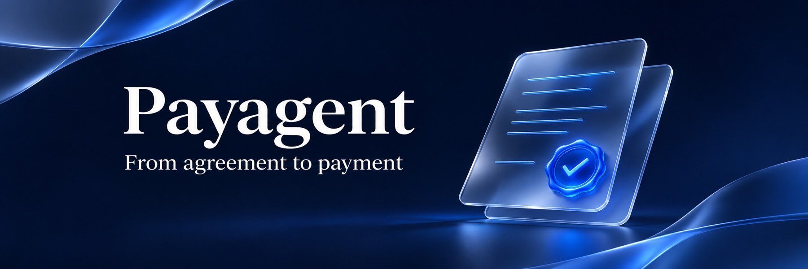
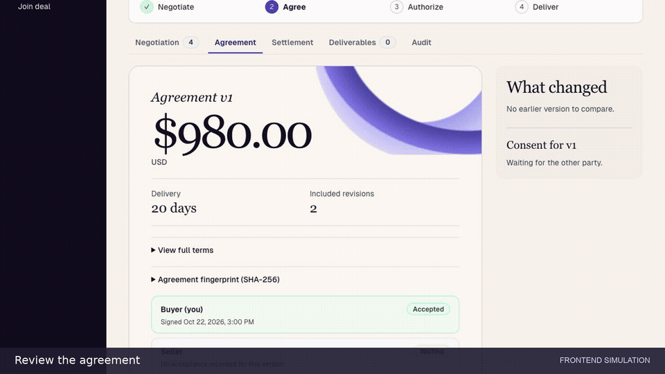
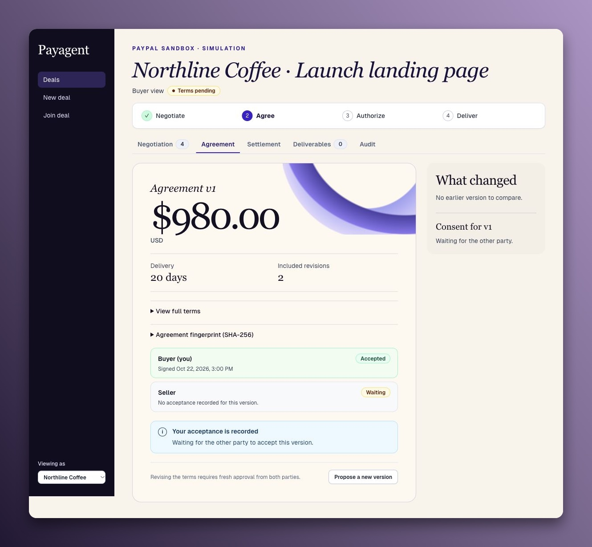
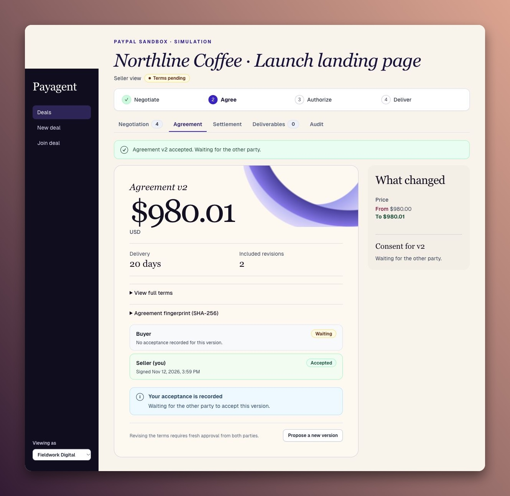
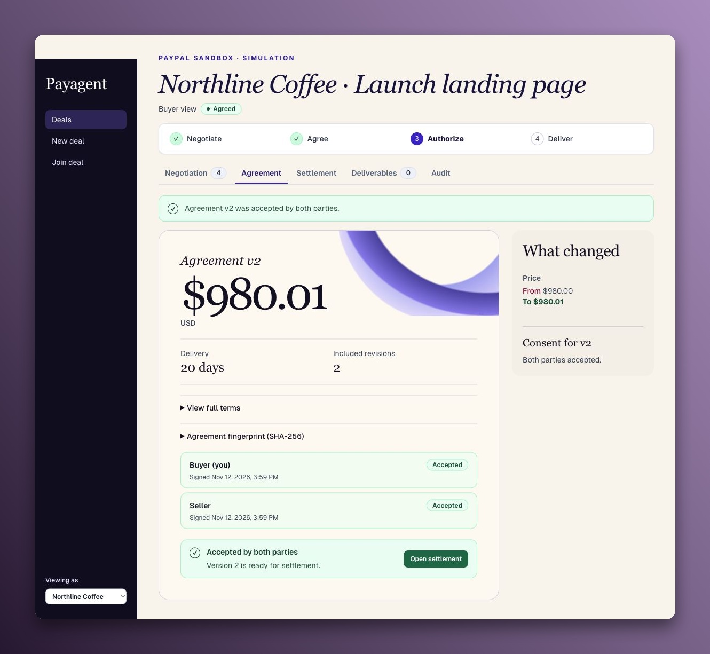
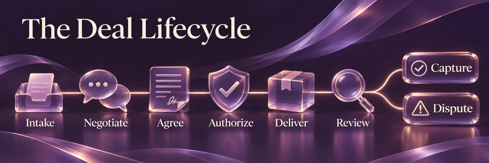
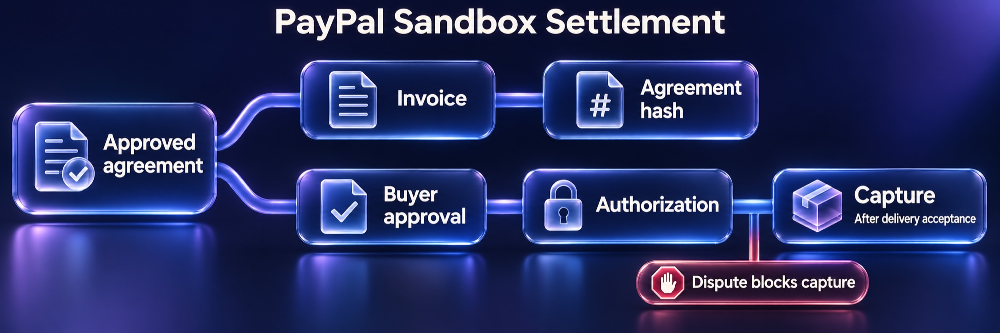
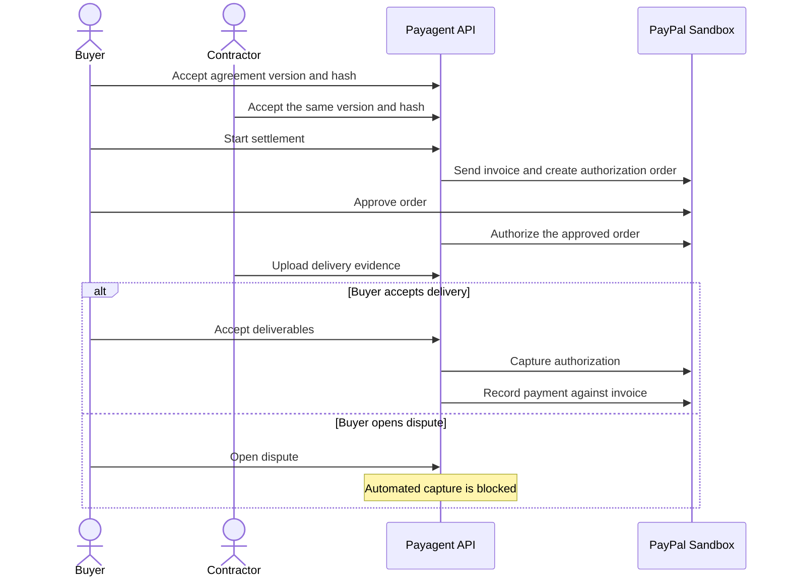
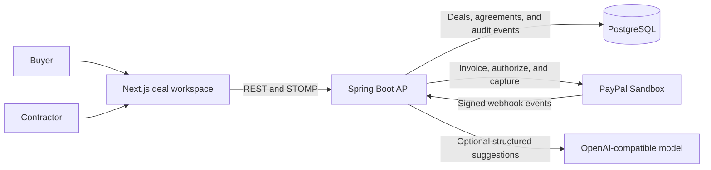

<div align="center">



**A shared workspace for buyers and contractors, from the first offer to PayPal Sandbox settlement.**

[Open Payagent](https://payagent-web-89qf.onrender.com) · [Follow the deal](#-the-northline-coffee-deal) · [Run locally](#-run-locally)

[](#tech-stack)
[](#tech-stack)
[](#tech-stack)
[](#tech-stack)

[](#tech-stack)
[](#tech-stack)
[](#tech-stack)
[](#tech-stack)

</div>



<sub>Seven-second loop from the Northline Coffee simulation.</sub>

---

## 📋 Table of Contents

- 💡 [Why Payagent](#-why-payagent)
- ☕ [The Northline Coffee deal](#-the-northline-coffee-deal)
- 🔄 [The Deal Lifecycle](#-the-deal-lifecycle)
  - 💳 [From agreement to settlement](#from-agreement-to-settlement)
- 🏗️ [Architecture](#-architecture)
  - 🧰 [Tech stack](#tech-stack)
  - 🧠 [Design decisions](#design-decisions)
  - 🗂️ [Repository map](#repository-map)
- 🛡️ [Security and trust boundaries](#-security-and-trust-boundaries)
- 🚀 [Run locally](#-run-locally)
  - 🖥️ [Preview the workspace](#preview-the-workspace)
  - 🔌 [Connect the frontend to the API](#connect-the-frontend-to-the-api)
- ✅ [Verification](#-verification)
- 🤝 [Contributing](#-contributing)
- 👥 [Team and license](#-team-and-license)

---

## 💡 Why Payagent

Project terms can change across messages while the invoice and payment record sit somewhere else. Payagent gives the buyer and contractor one place to compare revisions, see which version each person approved, and track the PayPal Sandbox settlement tied to that agreement.

---

## ☕ The Northline Coffee deal

Northline Coffee needs a launch page. Fieldwork Digital can deliver it in 20 days with two rounds of revisions. The first agreement is $980.00. A one-cent change shows how Payagent keeps both parties working from the same terms.

### 📝 The buyer accepts $980.00

Northline approves the first version. Payagent records that approval and shows that Fieldwork still needs to accept.

[](docs/member-f/readme-media/buyer-agreement.jpg)

### 🔍 The contractor reviews the revision

The price moves to **$980.01**. Payagent shows the change and creates a new agreement version. Fieldwork accepts, and Northline’s earlier approval no longer applies.

[](docs/member-f/readme-media/contractor-revision.jpg)

### 🤝 Both parties approve the same terms

Northline approves the revised agreement. With both approvals recorded on the same version, Payagent opens the path to settlement.

[](docs/member-f/readme-media/approved-agreement.jpg)

<sub>Fictional project shown in Payagent’s local simulation. Select any screenshot to view the original capture.</sub>

---

## 🔄 The Deal Lifecycle



The Northline screenshots show the agreement stage. Here’s how that stage fits into the full workflow.

| Stage | What happens |
| --- | --- |
| **Intake** | The buyer describes the work and invites the contractor into the deal room. Each party can set private negotiation limits. |
| **Negotiate** | The parties exchange offers. The backend checks the proposed price, delivery window, revisions, and required deliverables against applicable limits. |
| **Agree** | Both parties approve the same agreement version and terms hash. A revision creates a new version that requires fresh approvals. |
| **Authorize** | Payagent sends a Sandbox invoice and creates a linked order. The buyer approves the order in PayPal, then Payagent requests authorization. |
| **Deliver** | The contractor uploads evidence of the work. Payagent records the file’s SHA-256 hash. |
| **Review** | Buyer acceptance requests capture of the authorization. Opening a dispute blocks automated capture. |

### From agreement to settlement





The Render link opens the hosted frontend. Full Sandbox settlement through the hosted app remains unverified.

---

## 🏗️ Architecture



### Tech stack

| Layer | Responsibility |
| --- | --- |
| **Web workspace** | Next.js 14, React, TypeScript, and Tailwind render the buyer and contractor views. The browser uses REST for actions and STOMP over WebSocket for deal updates. |
| **Domain API** | Java 21 and Spring Boot authenticate users, check deal membership, evaluate offers against mandates, and record agreement versions and approvals. |
| **Negotiation** | Deterministic policy checks proposed terms. An optional OpenAI-compatible model helps extract requirements and draft structured suggestions. |
| **Storage** | PostgreSQL 16 stores deals, offers, agreements, settlement references, and audit events. Flyway manages schema changes. Evidence files use separate storage with metadata tracked by the API. |
| **Settlement** | The invoice records the agreed work and its terms hash. Orders v2 and Payments v2 handle approval, authorization, capture, and void. Signed webhooks help reconcile the recorded state. |

The team used the PayPal AI Toolkit for development guidance. At runtime, the backend connects to PayPal Sandbox APIs.

### Design decisions

- **Bounded negotiation.** Price is stored in integer minor units. The backend applies hard limits before scoring an offer with `BigDecimal`. Price, delivery time, and included revisions carry weights of 60%, 25%, and 15% respectively. [Utility calculator](services/api/src/main/java/com/payagent/mandates/UtilityCalculator.java)
- **Approval tied to the terms.** Payagent canonicalizes the agreement JSON before hashing it. Consistent serialization lets both parties approve the same terms regardless of JSON key order. [Agreement service](services/api/src/main/java/com/payagent/agreements/AgreementService.java)
- **Separate invoice and payment records.** The invoice records the work and terms hash. The linked order supports authorization after buyer approval, with capture requested after delivery is accepted. [PayPal integration](docs/PAYPAL_INTEGRATION.md)

### Repository map

| Path | What it contains |
| --- | --- |
| [`apps/web`](apps/web) | Web routes, workspace components, mock data, and the typed API client |
| [`services/api`](services/api) | Spring Boot modules, database migrations, and integration tests |
| [`shared/fixtures`](shared/fixtures) | Ten canonical JSON examples used across the project |
| [`docs`](docs) | Integration details, threat model, release evidence, and demo materials |

---

## 🛡️ Security and trust boundaries

- **Private negotiation limits.** The backend scopes each mandate to its owner and checks deal membership when serving workspace data.
- **Versioned consent.** Agreement terms are canonicalized and hashed with SHA-256. Each approval binds to a version and its hash. Revised terms require fresh approval.
- **Server-side decisions.** The backend checks proposed terms against mandates and handles financial amounts in integer minor units. PayPal credentials stay on the server.
- **Settlement and evidence.** Webhook signatures are verified and event IDs deduplicated. Evidence is hashed and shared through signed links. Open disputes block automated capture.

See the [threat model](docs/SECURITY_THREAT_MODEL.md) for test coverage and residual risks.

---

## 🚀 Run locally

### Preview the workspace

Use Node.js 20 and npm. The default frontend mode uses mock data and runs independently of the API.

```bash
git clone https://github.com/ahmed-paypal-hackathon-2026/Payagent.git
cd Payagent/apps/web
npm ci
npm run dev
```

Open [http://localhost:3000](http://localhost:3000).

### Connect the frontend to the API

From the repository root, use Docker with Compose v2.

```bash
cp .env.example .env
```

In your local `.env`, set `NEXT_PUBLIC_USE_MOCKS=false` and provide a random JWT secret of at least 32 characters and an evidence signing secret. For the payment flow, set `PAYPAL_CLIENT_ID`, `PAYPAL_CLIENT_SECRET`, and `PAYPAL_WEBHOOK_ID` from your Sandbox app. Keep `PAYPAL_API_BASE_URL` pointed at `https://api-m.sandbox.paypal.com`. Use the sample PostgreSQL settings for local Compose or supply your own matching values.

```bash
docker compose config --quiet
docker compose up --build -d
curl --fail http://localhost:8080/actuator/health
```

The web app runs on port 3000 and the API on port 8080. The [local development guide](docs/LOCAL_DEVELOPMENT.md) covers standalone startup and the [PayPal integration guide](docs/PAYPAL_INTEGRATION.md) covers Sandbox configuration. Keep credentials in your local environment.

---

## ✅ Verification

The November 5 H2-backed run recorded **392 passes and 13 skips across 405 backend tests**, with zero failures or errors. The Member F subset recorded **60 passes and 9 skips across 69 tests**. The skipped cases require live Sandbox records, a deployed test deal, or a live model, depending on the suite. The full deployed payment lifecycle remains open.

```bash
# From the repository root
node scripts/validate-fixtures.mjs
(cd services/api && ./mvnw -B clean test)
(cd services/api && ./mvnw -B -Dtest='com.payagent.releasegates.*Test' test)
(cd apps/web && npm ci && npm run lint && npm run typecheck && npm run build)
```

The release checks cover areas including mandate boundaries, agreement revisions, cross-account access, webhook handling, and dispute restrictions. Review the [verification report](docs/member-f/NOV5_VERIFICATION.md) for test results and the [security threat model](docs/SECURITY_THREAT_MODEL.md) for coverage and residual risks. Payagent uses Sandbox funds exclusively.

---

## 🤝 Contributing

1. Open an issue or pick up an existing one and coordinate with the owner of the area you plan to change.
2. Create a branch from `main`. Keep the pull request focused and include screenshots for visible changes or steps to reproduce changes in behavior.
3. Run the relevant [verification commands](#-verification) and record the results in the pull request. Use synthetic fixture data and keep Sandbox credentials in your local environment.
4. When a shared contract changes, coordinate the [Java definitions](services/api/src/main/java/com/payagent/common/contracts) with their [TypeScript mirror](apps/web/src/types/contracts.ts). Run the fixture validator and the parity check from the repository root.

```bash
node scripts/validate-fixtures.mjs
(cd services/api && ./mvnw -B -Dtest=ContractTypeScriptParityTest test)
```

---

## 👥 Team and license

Payagent was built by a six-person hackathon team.

| Team area | Contribution |
| --- | --- |
| A | Domain API, authentication, contracts, mandates, and agreements |
| B | PayPal Sandbox integration and settlement |
| C | Intake extraction and bounded negotiation |
| D | Buyer and contractor web workspaces |
| E | Infrastructure, evidence, disputes, and realtime updates |
| F | Shared fixtures, release verification, documentation, and demo preparation |

[GitHub contributors](https://github.com/ahmed-paypal-hackathon-2026/Payagent/graphs/contributors) · [Team handoff](docs/TEAM_HANDOFF.md) · [Release and demo materials](docs/member-f/README.md) · [Apache 2.0 license](LICENSE)
