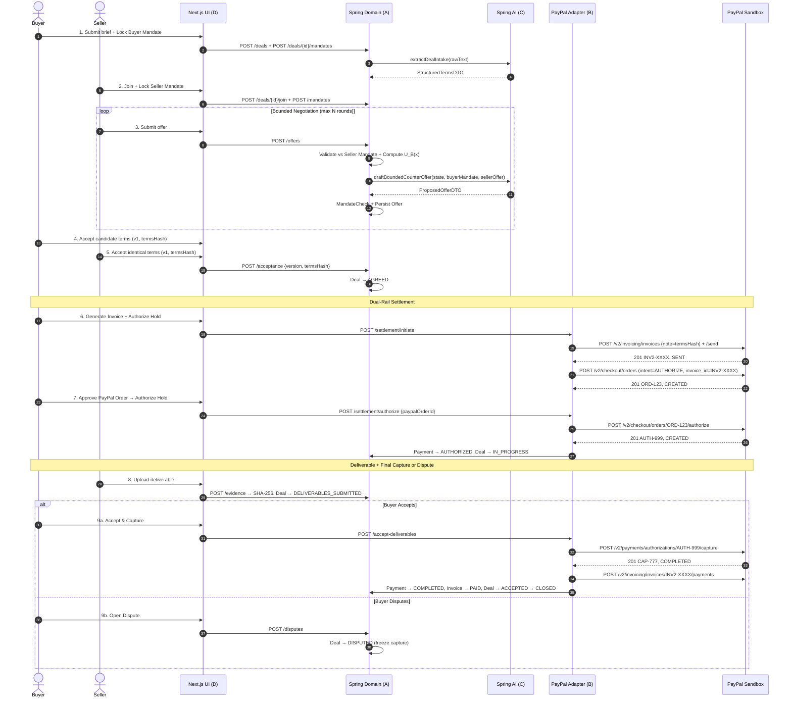

# Payagent — Architecture Documentation

**Source of truth:** `plan v2.docx` (extracted to `docs/_plan_extract.txt`) and `AGENTS.md`.  
**Status:** Documents the *planned* architecture. Implementation is in scaffolding phase.

---

## 1. Component Boundaries

### 1.1 Frontend — Next.js 14 SPA (`apps/web/`, Member D)

| Subsystem | Responsibility | Key Files (Planned) |
|-----------|----------------|---------------------|
| **Buyer Workspace** | Intake brief → structured terms, mandate lock, offer review, approval, dispute | `app/deals/buyer/*`, `components/NegotiationRoom/*` |
| **Seller Workspace** | Join via invite, seller mandate, counteroffers, deliverable upload | `app/deals/seller/*`, `components/NegotiationRoom/*` |
| **Deal Room** | Split-view red/green term diffs across rounds, utility gauge, dual signature | `components/NegotiationRoom/DealRoom.tsx` |
| **Settlement Panel** | Invoice (INV2-...) + Order Authorization (AUTH-...) status cards | `components/SettlementPanel/*` |
| **Evidence Panel** | File upload (max 10MB), SHA-256 badge, Accept/Dispute controls | `components/EvidencePanel/*` |
| **Audit Timeline** | Immutable WebSocket event replay with cursor (`?afterSeq=`) | `components/AuditTimeline/*` |
| **Typed API Client** | Fetch wrapper using `contracts.ts` types, mock mode support | `lib/api.ts` |

**Data flow:** UI ↔ REST (`/api/v1/*`) + WebSocket (`/ws/deals/{id}`) ↔ Backend

---

### 1.2 Backend — Spring Boot 3.3 Modular Monolith (`services/api/`, Members A,B,C,E)

```
com.payagent
├── common.contracts          # Member A — Canonical DTOs & Enums (single source of truth)
├── auth                      # Member A — JWT login, stateless filter, deal guard
├── deals                     # Member A — Deal CRUD, offer lifecycle, state machine
├── mandates                  # Member A — Versioned mandates, UtilityCalculator (BigDecimal)
├── agreements                # Member A — AgreementService, RFC-8785 SHA-256 hash, dual consent
├── paypal                    # Member B — OAuth2 cache, Invoicing v2, Orders v2, Payments v2
├── settlement                # Member B — Dual-rail flow controller (initiate, authorize, capture, void)
├── ai                        # Member C — IntakeExtractor, NegotiationAgent, PromptSanitizer
├── evidence                  # Member E — SHA-256 storage, signed URLs, MIME allowlist
├── disputes                  # Member E — Dispute creation, freeze capture, resolution
├── realtime                  # Member E — WebSocket STOMP broker, cursor replay, mandate masking
├── config                    # Member A/E — SecurityConfig, PayPalEnvironmentGuard
└── web                       # Member A — HealthController, future REST controllers
```

---

### 1.3 Database — PostgreSQL 16 (Flyway Managed)

**Tables (from `V1__init.sql`):**
- `users` — authentication
- `deals` — deal lifecycle, status, invite token
- `mandates` — versioned per party per deal (unique on deal_id, party_role, version)
- `offers` — negotiation rounds, terms JSON, utility score, mandate compliance
- `agreements` — canonical terms JSON, terms_hash_sha256, acceptance timestamps
- `invoices` — PayPal Invoicing v2 linkage, lifecycle status
- `payments` — PayPal Orders v2 linkage, authorization/capture IDs, expiry
- `evidence` — deliverable files metadata, SHA-256, storage key, version
- `disputes` — status, reason, resolution request, timestamps
- `paypal_events` — webhook deduplication (PK on event_id)
- `audit_events` — sequenced events per deal for WebSocket replay
- `idempotency_keys` — request deduplication (composite PK: idempotency_key, route)

**Indexes:** `idx_deals_buyer`, `idx_deals_seller`, `idx_offers_deal`, `idx_audit_deal_seq`

---

### 1.4 External Integrations

| Service | Protocol | Purpose | Owner |
|---------|----------|---------|-------|
| PayPal Sandbox | HTTPS REST | OAuth2, Invoicing v2, Orders v2 (AUTHORIZE), Payments v2 (CAPTURE/VOID), Webhooks | Member B |
| LLM Endpoint | HTTPS (OpenAI-compatible) | Structured intake extraction, bounded counteroffer generation | Member C |

---

## 2. REST & WebSocket Architecture

### 2.1 REST Endpoints (Canonical Contract)

| Method & Path | Owner | Request | Response | Key Guardrail |
|---------------|-------|---------|----------|---------------|
| `POST /api/v1/auth/login` | A | `{email, password}` | `{token, userId, email}` | BCrypt, HS256 JWT |
| `POST /api/v1/deals/intake` | A,C | `{rawPrompt, currency}` | `{dealId, extractedTerms, inviteToken}` | Calls AI extractor |
| `POST /api/v1/deals/{id}/join` | A | `{inviteToken}` | `DealWorkspaceDTO` | Verifies caller ≠ creator |
| `POST /api/v1/deals/{id}/mandates` | A | `MandateCreateRequest` + `Idempotency-Key` | `MandateDTO` | **Never exposed to counterparty** |
| `POST /api/v1/deals/{id}/offers` | A | `{terms, message}` + `Idempotency-Key` | `OfferDTO` | Rejects 422 if violates caller's mandate |
| `POST /api/v1/deals/{id}/negotiate-step` | A,C | `Idempotency-Key` | `OfferDTO` | Invokes LLM, validates against mandate + utility |
| `POST /api/v1/deals/{id}/acceptance` | A | `{agreementVersion, termsHashSha256}` | `AgreementSnapshotDTO` | 409 if hash mismatch |
| `POST /api/v1/deals/{id}/settlement/initiate` | B | `Idempotency-Key` | `SettlementStateDTO` | Requires `AGREED` status; creates Invoice + Order |
| `POST /api/v1/deals/{id}/settlement/authorize` | B | `{paypalOrderId}` + `Idempotency-Key` | `SettlementStateDTO` | Calls Order authorize, stores auth ID, `IN_PROGRESS` |
| `POST /api/v1/deals/{id}/evidence` | E | `multipart/form-data` | `DeliverableEvidenceDTO` | SELLER only, max 10MB, SHA-256, `DELIVERABLES_SUBMITTED` |
| `POST /api/v1/deals/{id}/accept-deliverables` | B,A | `{evidenceVersion}` + `Idempotency-Key` | `SettlementStateDTO` | BUYER only; capture + invoice payment |
| `POST /api/v1/deals/{id}/disputes` | E,B | `{reason, resolutionRequest}` | `DealWorkspaceDTO` | Immediate `DISPUTED`, blocks capture |
| `POST /api/v1/paypal/webhooks` | B | Raw JSON + `PAYPAL-*` headers | `200 OK` | Verify signature, deduplicate `event_id` |

### 2.2 WebSocket (STOMP)

| Endpoint | Auth | Protocol | Payload | Features |
|----------|------|----------|---------|----------|
| `WSS /ws/deals/{id}` | JWT in header | STOMP over WebSocket | `DealEventEnvelope` | `?afterSeq=` replay, masks counterparty mandate fields |

---

## 3. Data Flow: End-to-End Negotiation & Settlement



---

## 4. Module Ownership Matrix

| Module | Owner | Key Classes (Planned) |
|--------|-------|----------------------|
| `common.contracts` | A | All 7 enums + 7 records |
| `auth` | A | `JwtTokenProvider`, `JwtAuthFilter`, `AuthController` |
| `deals` | A | `DealService`, `DealController`, `DealStateMachine` |
| `mandates` | A | `MandateService`, `UtilityCalculator` (BigDecimal UB/US) |
| `agreements` | A | `AgreementService`, `Rfc8785Canonicalizer`, `Sha256Hasher` |
| `paypal` | B | `PayPalAuthClient`, `PayPalInvoiceService`, `PayPalOrderService`, `PayPalWebhookController` |
| `settlement` | B | `SettlementController`, `SettlementService` (dual-rail orchestrator) |
| `ai` | C | `IntakeExtractionService`, `NegotiationAgentService`, `PromptSanitizer`, `ModelBenchmarkRunner` |
| `evidence` | E | `EvidenceStorageService`, `EvidenceController` |
| `disputes` | E | `DisputeService`, `DisputeController` |
| `realtime` | E | `DealWebSocketBroker`, `StompConfig`, `AuditEventPublisher` |
| `config` | A/E | `SecurityConfig`, `PayPalEnvironmentGuard` |

---

## 5. Contract Source of Truth

- **Java (canonical):** `services/api/src/main/java/com/payagent/common/contracts/`
- **TypeScript (mirror):** `apps/web/src/types/contracts.ts`
- **Parity enforcement:** `ContractTypeScriptParityTest.java` (enum literals), `ContractFixtureDeserializationTest.java` (DTO shapes)
- **Change protocol:** Member A updates Java → Member D updates TypeScript in same PR → run parity test → merge

---

## 6. State & Settlement Concepts

### 6.1 Deal Status Machine
```
DRAFT → INVITED → ACTIVE_NEGOTIATION → TERMS_PENDING_ACCEPTANCE
    → AGREED → SETTLEMENT_PENDING → IN_PROGRESS → DELIVERABLES_SUBMITTED
        → ACCEPTED → CLOSED
    ↘ DISPUTED → (RESOLVED_RELEASE_CAPTURE | RESOLVED_VOID_AUTHORIZATION) → CLOSED
    ↘ CANCELLED (any time by mutual agreement or mandate expiry)
```

### 6.2 Negotiation Stop Reasons
`NONE`, `CONVERGED`, `NO_ZOPA_DETECTED`, `MAX_ROUNDS_REACHED`, `MANDATE_EXPIRED`, `USER_PAUSED`, `POLICY_VIOLATION_BLOCKED`

### 6.3 Dual-Rail Settlement
1. **Invoice Rail (commercial record):** PayPal Invoicing v2 — `INV2-...`, `SENT` → `PAID`
2. **Authorization Rail (funds hold):** PayPal Orders v2 — `intent:AUTHORIZE` → `AUTH-...` (29-day hold) → `CAPTURE` → `COMPLETED` or `VOID`

### 6.4 Agreement Hash Integrity
- `termsHashSha256` = SHA-256(RFC-8785 canonical JSON of `canonicalTerms`)
- Any modification → new version, new hash, prior `buyerAcceptedAt`/`sellerAcceptedAt` cleared
- Dual consent requires **identical** hash from both parties

---

## 7. Security Boundaries (Trust Zones)

```
┌─────────────────────────────────────────────────────────────┐
│                    PUBLIC INTERNET                          │
│  ┌─────────────┐  ┌─────────────────────────────────────┐  │
│  │ Buyer Browser │  │ Seller Browser                   │  │
│  └──────┬────────┘  └──────────────┬────────────────────┘  │
└─────────│─────────────────────────│─────────────────────────┘
          │ HTTPS/WSS               │ HTTPS/WSS
          ▼                         ▼
┌─────────────────────────────────────────────────────────────┐
│                    NGINX / LOAD BALANCER (Future)           │
└────────────────────────────┬────────────────────────────────┘
                             │
          ┌──────────────────┼──────────────────┐
          ▼                  ▼                  ▼
┌─────────────────┐ ┌─────────────────┐ ┌─────────────────┐
│   WEB TIER      │ │   API TIER      │ │   DATA TIER     │
│  (Next.js)      │ │  (Spring Boot)  │ │  (PostgreSQL)   │
│  Member D       │ │  Members A,B,C,E│ │  Member A (schema)│
└─────────────────┘ └────────┬────────┘ └─────────────────┘
                             │
              ┌──────────────┼──────────────┐
              ▼              ▼              ▼
       ┌───────────┐  ┌───────────┐  ┌───────────┐
       │ PayPal    │  │ LLM       │  │ File      │
       │ Sandbox   │  │ Endpoint  │  │ Storage   │
       │ (External)│  │ (External)│  │ (Local/S3)│
       └───────────┘  └───────────┘  └───────────┘
```

**Trust boundaries:**
- **Browser ↔ API:** JWT auth, Idempotency-Key, object-level authorization
- **API ↔ PayPal:** Sandbox-only, OAuth2 token cache, webhook signature verification
- **API ↔ LLM:** No credentials, untrusted input sanitized, output schema validated
- **API ↔ DB:** Flyway migrations, parameterized queries, no raw SQL
- **Evidence storage:** Outside web root, SHA-256, HMAC-signed URLs, membership check

---

## 8. Current Implementation Status

| Layer | Implemented | Planned / In Progress |
|-------|-------------|----------------------|
| Contracts (Java) | ✅ 7 enums + 7 records | — |
| Contracts (TypeScript) | ✅ Exact mirror | — |
| Flyway V1 schema | ✅ 11 tables + indexes | Future migrations (Member A) |
| Health endpoint | ✅ `/api/v1/health`, `/actuator/health` | — |
| SecurityConfig | ✅ Stateless, permits health | JWT filter, deal guard (Member A) |
| PayPalEnvironmentGuard | ✅ Sandbox-only startup check | — |
| Docker Compose | ✅ Postgres + API + Web | Healthchecks tuned |
| Frontend landing page | ✅ Static build works | Full UI (Member D) |
| Fixtures (10 JSON) | ✅ Valid, aligned with DTOs | — |
| CI workflow | ✅ 6 jobs configured | Requires Maven/Docker/Gitleaks |
| Domain controllers/services | ❌ | Member A |
| PayPal adapter | ❌ | Member B |
| AI engine | ❌ (Spring AI not in pom.xml) | Member C |
| Evidence/Disputes/Realtime | ❌ | Member E |
| Release gate tests | ❌ (placeholder only) | Member F |

---

## 9. Non-Functional Requirements

| Requirement | Target |
|-------------|--------|
| API p95 latency (local) | < 200ms |
| AI extraction p95 | < 5s (20-prompt benchmark) |
| Docker Compose cold start | < 3 minutes |
| Frontend build time | < 2 minutes |
| Test suite (full CI) | < 10 minutes |
| PayPal Sandbox round-trip | < 10s (OAuth + Invoice + Order) |
| WebSocket replay | < 100ms for 100 events |

---

## 10. Future Extensibility

- **Multi-tenancy:** Add `tenant_id` to all tables, row-level security
- **Payment providers:** Abstract `PaymentAdapter` interface for Stripe, etc.
- **LLM providers:** Spring AI abstraction supports OpenAI, Anthropic, Ollama, vLLM
- **Event sourcing:** `audit_events` table designed for full replay
- **Horizontal scaling:** Stateless API, sticky sessions for WebSocket (Redis-backed STOMP broker)